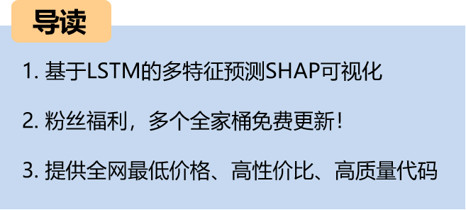
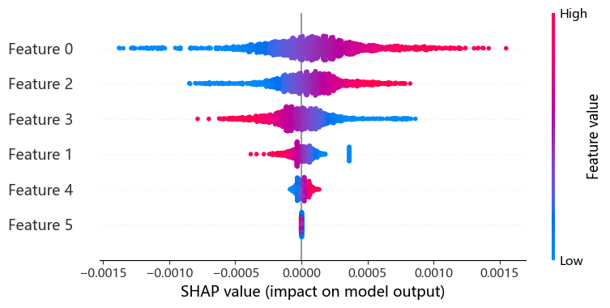
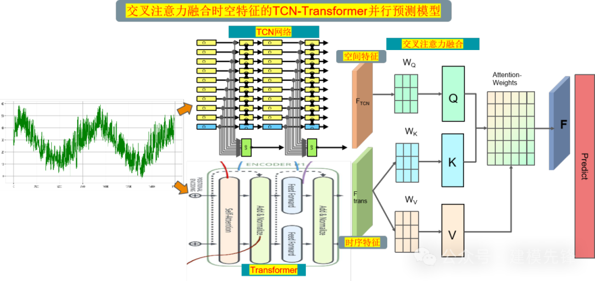
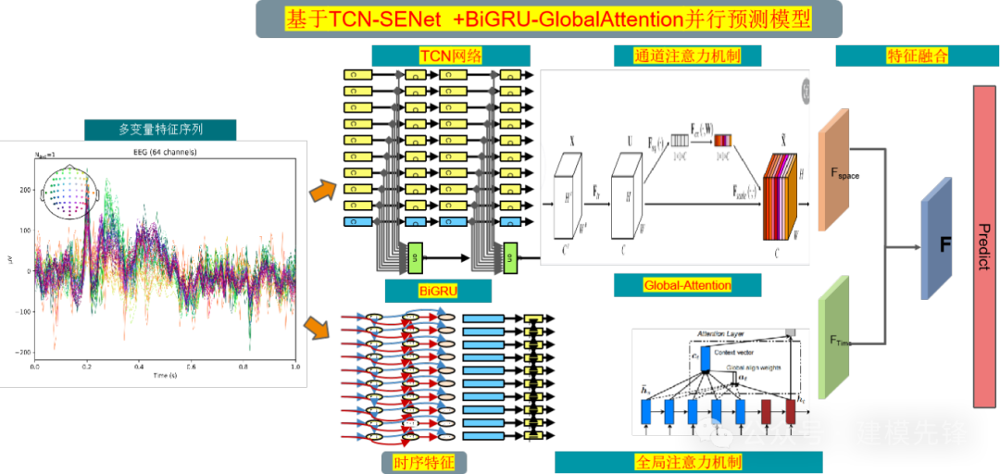
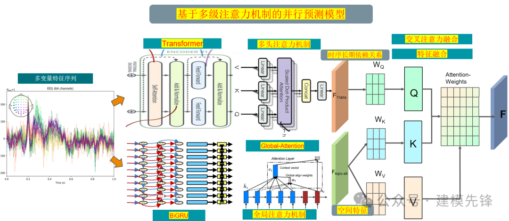
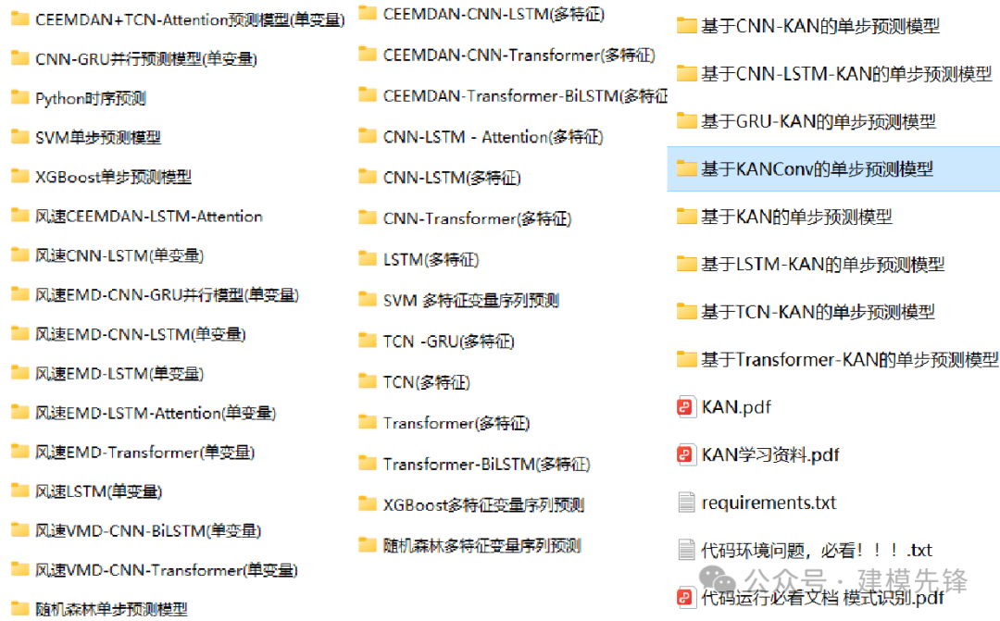
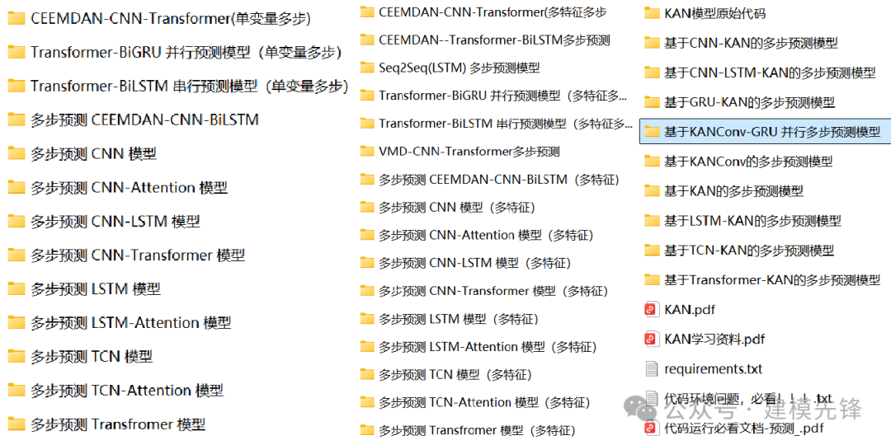
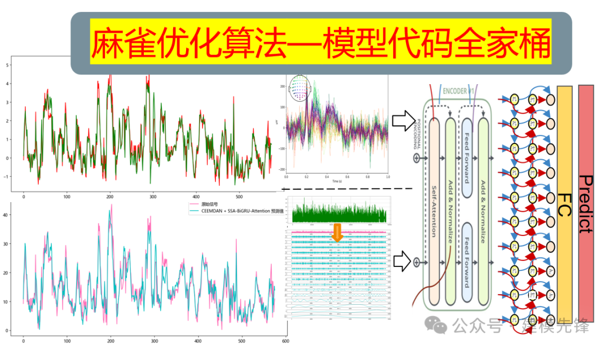
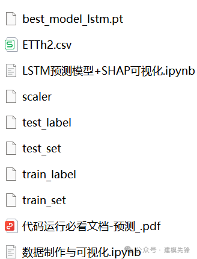

# LSTM-based Multi-Feature Sequence Prediction with SSHAP Visualization!

\tNote: This tutorial only uses the LSTM model for feature sequence prediction in previous periods to conduct SHAP visualization analysis. According to the code provided, you can directly migrate to our previous models for multi-feature sequence prediction!
5 SHAP Visualization Analysis Update Range
\t  
(1) | SCI Category I High Innovation Prediction Model
TCN-Transformer Parallel Prediction Model Based on Cross Attention Fusion of Spatio-Temporal Features
(2) | Based on the TCN-SENet +BiGRU-GlobalAttention parallel prediction model
TCN-SENet +BiGRU-GlobalAttention Parallel Prediction Model
(3) Parallel prediction model based on multi-level attention mechanism
Parallel prediction model based on multi-level attention mechanism
(4) Step-by-step prediction of the whole family set.
\tStrongest Update | One-time ownership, comprehensive mastery of Python time series prediction
(5) Multi-step prediction family set
Hotspot Innovation | Multi-Step Prediction Model Based on KANConv-GRU Parallelism
(6) Sparrow Optimization Algorithm - Innovation Prediction Model Full Set
\tInnovative Prediction Model Based on Optimization Algorithms in Python
(7) Secondary Decomposition - Innovative Model Prediction for the Full Family Set
\tVMD + CEEMDAN secondary decomposition, TCN-Transformer parallel prediction model
Click to download: Complete original data, Python code
Previously Featured Content:
From Beginner to Publication | The Most Comprehensive Collection of Time Series Forecasting
High Innovation | CEEMDAN + SSA-TCN-BiLSTM-Attention Predictive Model
| Based on TCN-SENet + BiGRU-GlobalAttention Parallel Prediction Model
| BiTCN-BiGRU-CrossAttention fusion of spatiotemporal features for high innovation prediction models
| Parallel prediction model based on multi-level attention mechanism
 | CEEMDAN-Transformer-BiLSTM parallel + XGBoost combination prediction
Strong prediction model | Family update for regression prediction
Innovative growth | Parallel prediction model based on Informer-LSTM
Free access (II) | Wind farm wind speed and power load datasets
| Parallel prediction model based on Informer + TCN-SENet
Strongest update | One-stop, comprehensive mastery of Python time series prediction
Ready-to-use | Time encoding + LSTM + global attention
Half a day to get started! Lithium battery remaining life prediction (Python)
Hotspot innovation | Parallel prediction model based on KANConv-GRU with multiple steps
Violent growth points! | Parallel prediction model based on Informer+BiGRU-GlobalAttention
Reject information leakage! VMD rolling decomposition + Informer-BiLSTM parallel prediction model
Time series prediction and classification | Open source code sharing (Part 1)
Major update! New CALCE dataset added to lithium battery remaining life prediction
VMD + CEEMDAN secondary decomposition, TCN-Transformer parallel prediction model
END

## Images

<!-- PAYMENT_BLOCK -->

## Get this dataset

- Payment link (Stripe): [Buy now](https://buy.stripe.com/3cs8yP7sY87d0vu9AB)
- Payment QR code: 

<!-- /PAYMENT_BLOCK -->
